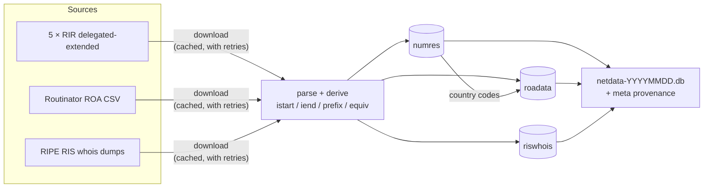

# RIR NETDATA

[](https://github.com/cm2c-internet-measurements/rir-netdata/actions/workflows/ci.yml)
[](https://github.com/cm2c-internet-measurements/rir-netdata/releases)
[](LICENSE)

**The Internet's number registries, in one SQLite file you can query.**

`rir-netdata` downloads public datasets about how IP addresses and AS numbers are delegated, routed and secured, enriches them, and writes them into a single self-contained SQLite database. You get a daily snapshot that answers questions like these with plain SQL, no scraping or parsing:

- *Who holds this address block, in which country, and since when?*
- *How much of Brazil's address space is covered by RPKI?*
- *Which ROAs authorize an origin AS registered in a different country than the prefix?*

```sh
uv run rir-netdata get        # → var/netdata-20261110.db  (~250 MB, ~3.4M rows, under a minute)
```

## What's in the database

Each run produces `netdata-YYYYMMDD.db` with four tables. It can optionally also produce **Parquet**, **CSV**, **DuckDB** and **gzipped** copies (see [Other formats](#other-formats)):

| Table | What it holds | Built from |
| --- | --- | --- |
| **`numres`** | Every IPv4, IPv6 and ASN delegation from the five Regional Internet Registries: holder country, status, date, and holder id | The *delegated-extended* statistics files of [AFRINIC](https://www.afrinic.net), [APNIC](https://www.apnic.net), [ARIN](https://www.arin.net), [LACNIC](https://www.lacnic.net) and [RIPE NCC](https://www.ripe.net) |
| **`roadata`** | Every validated RPKI ROA from all five trust anchors, tagged with the country of the prefix and of its origin AS | A [Routinator](https://routinator.docs.nlnetlabs.nl/) CSV export |
| **`riswhois`** | Which AS originates each prefix in the global BGP table, how many RIS peers see it, and its **RPKI validity** (`valid` / `invalid` / `notfound`) | [RIPE RIS](https://ris.ripe.net) whois dumps, IPv4 and IPv6 |
| **`meta`** | Provenance: the URL, fetch time, source serial, row count and SHA-256 of every input file | The run itself |

Every row also gets **convenience columns**, so range and size questions become simple comparisons:

| Column | Meaning |
| --- | --- |
| `istart`, `iend` | The block as an **inclusive integer range**: IPv4 addresses as integers, IPv6 in units of /64, ASNs as numbers. "Is X inside Y?" becomes `istart <= x AND x <= iend`. |
| `type` | `ipv4`, `ipv6` or `asn` |
| `prefix`, `pfxlen` | CIDR notation and prefix length. Delegations that aren't a clean CIDR get a range, `a.b.c.d-e.f.g.h`. |
| `equiv`, `equiv2` | Size in /24 equivalents (IPv4) or /32 equivalents (IPv6). `roadata.equiv2` gives the exact integer size in /24s or /64s. |

**[SPEC.md](SPEC.md)** is the full reference: every column, unit and rule.

## Goals

- **One file, plain SQL.** No server and no API keys, just a file. Open it with `sqlite3`, DB Browser, DuckDB, pandas, R or anything else that speaks SQLite.
- **A stable contract.** The data is published as open data, and people write scripts against it. Table and column names, types and units don't change silently; any change is recorded in SPEC.md first.
- **Honest data.** If any source fails after retries, the run fails and no file is written, so you never get a half-built snapshot. Every file records exactly which inputs it was built from.
- **Faithful to the sources.** Values are kept as the registries publish them. Derived columns only add to them, and where the registries' own data is ambiguous, SPEC.md says how it is interpreted.
- **Simple to run anywhere.** One command on a laptop, a cron job or a container.

## How it works



1. **Download** every source over HTTPS, each from its operator's own server. Files are cached, and transient failures are retried with backoff.
2. **Parse and derive.** Each file is streamed, its comment and summary lines are skipped, and the convenience columns are computed. Delegated files are checked against their own summary counts, which catches truncated downloads.
3. **Enrich.** ROAs get the country codes of their prefix and origin AS, looked up in `numres`. Every BGP route gets its RPKI route origin validation status (RFC 6811), computed against all ROAs.
4. **Publish atomically.** The database is built in a temporary file and renamed into place only when every step has succeeded.

## Getting started

### Run it locally

You need [uv](https://docs.astral.sh/uv/), which fetches a suitable Python (≥ 3.12) by itself if needed.

```sh
git clone https://github.com/cm2c-internet-measurements/rir-netdata.git
cd rir-netdata
uv sync
uv run rir-netdata get
```

Progress bars show every download, load and enrichment step. The result is in `var/`.

A few useful variations:

```sh
uv run rir-netdata get --source delegated        # only the RIR delegations
uv run rir-netdata get --rir lacnic              # only one registry's delegations
uv run rir-netdata get --output-dir /srv/data    # write somewhere else
uv run rir-netdata get --config netdata.toml     # override URLs, retries, cache…
uv run rir-netdata get --export parquet,csv      # also write Parquet and CSV copies
uv run rir-netdata --help
```

Country codes in `roadata` come from `numres`. A run without the delegated files (for example `--source rpki`) leaves them empty and tells you so.

### Run it in a container

```sh
make build           # or: make build ENGINE=podman
make image-run       # database → ./var, download cache → ./tmp
```

Or run the image directly:

```sh
docker run --rm -v "$PWD/var:/data/var" -v "$PWD/tmp:/data/tmp" carlosm3012/rir-netdata:latest
```

Mounting `tmp/` is optional, but it keeps downloads cached between runs.

### Configure it

The defaults work out of the box. To point at a mirror, use another RPKI validator, or tune retries and caching, pass a small TOML file with `--config`:

```toml
cache_dir = "/var/cache/netdata"

[retry]
attempts = 5

[sources.rpki]
url = "https://my-validator.example.net/csv"
```

Every key is optional, and a misspelled key is an error rather than being silently ignored. All the settings are listed in [`config.py`](src/rir_netdata/config.py).

### Other formats

The SQLite file is always produced. Add `--export` to get copies in other formats, written to a folder next to the database:

```sh
uv run rir-netdata get --export parquet,csv,duckdb,sqlite.gz
# var/netdata-YYYYMMDD.db
# var/netdata-YYYYMMDD.db.gz
# var/netdata-YYYYMMDD/numres.parquet, roadata.parquet, riswhois.parquet, meta.parquet
# var/netdata-YYYYMMDD/netdata-YYYYMMDD.csv.tar.gz
# var/netdata-YYYYMMDD/netdata-YYYYMMDD.duckdb

uv run rir-netdata export var/netdata-20261110.db --format parquet   # convert any existing db
```

- **Parquet** keeps every column typed (integers, floats, strings, NULLs), so it's the best choice for DuckDB, pandas, Polars, Spark or R.
- **CSV** is for everything else. An empty field means NULL.
- **DuckDB** is a single file with the same typed tables as Parquet: `duckdb var/netdata-YYYYMMDD/netdata-YYYYMMDD.duckdb`.
- **`sqlite.gz`** is the `.db` itself, gzipped (about a quarter of the size), for downloading. `gunzip` it to get the identical file.

The typed schema is in [SPEC.md §5.7](SPEC.md#57-exports-since-21). A JSON Lines export is planned ([#12](https://github.com/cm2c-internet-measurements/rir-netdata/issues/12)).

```sql
-- DuckDB queries the Parquet files in place
SELECT rovstatus, count(*) FROM 'var/netdata-20261110/riswhois.parquet' GROUP BY 1;
```

## Querying the data

```sh
sqlite3 var/netdata-20261110.db
```

```sql
-- Which delegation contains 200.7.84.1?  (200.7.84.1 as an integer = 3355923457)
SELECT rir, cc, prefix, status, date FROM numres
WHERE type = 'ipv4' AND istart <= 3355923457 AND iend >= 3355923457;

-- RPKI coverage: ROAs and /24s covered, by country
SELECT cc, count(*) AS roas, sum(equiv) AS slash24s
FROM roadata WHERE type = 'ipv4'
GROUP BY cc ORDER BY roas DESC LIMIT 10;

-- ROAs whose origin AS is registered in a different country than the prefix
SELECT prefix, origin_as, cc, origin_as_cc FROM roadata
WHERE cc <> origin_as_cc AND 'ZZ' NOT IN (cc, origin_as_cc);

-- RPKI-invalid routes in BGP, and why (wrong origin AS, too specific, or an AS-set)
SELECT rovreason, count(*) FROM riswhois WHERE rovstatus = 'invalid' GROUP BY rovreason;

-- Which inputs was this file built from?
SELECT source, fetched_at_utc, source_serial, row_count FROM meta;
```

> **Tip:** to turn an address into the integer `istart`/`iend` use, run `python3 -c "import ipaddress; print(int(ipaddress.ip_address('200.7.84.1')))"`. For IPv6, shift the result right by 64 bits (`>> 64`).

## Project status and history

`rir-netdata` started at LACNIC in the early 2010s as a set of Python 2 scripts for research on Internet number resources. **Version 2.0** (November 2026) is a ground-up Python 3 rewrite. It keeps the original database schema, so existing analysis scripts keep working, and it fixes a number of long-standing data issues. [SPEC.md §7](SPEC.md#7-deliberate-deviations-from-the-legacy-pipeline-bug-fixes) lists every one of them.

| Document | For |
| --- | --- |
| [SPEC.md](SPEC.md) | The data contract: inputs, processing rules, schema, units |
| [PLAN.md](PLAN.md) | How the 2.0 rewrite was staged and checked against the legacy output |
| [CLAUDE.md](CLAUDE.md) | Code layout, conventions and gotchas for contributors (human or AI) |
| [Releases](https://github.com/cm2c-internet-measurements/rir-netdata/releases) | Changelog |

## Contributing

```sh
make test      # ruff lint + format check + the offline test suite
```

Tests never touch the network unless asked to (`uv run pytest -m network`). Their fixtures are trimmed lines from real registry files. Before changing anything that affects the output, read SPEC.md: the schema is a public contract.

## License and author

BSD 2-Clause. See [LICENSE](LICENSE).

Created and maintained by **Carlos M. Martinez** ([carlos@lacnic.net](mailto:carlos@lacnic.net)).
